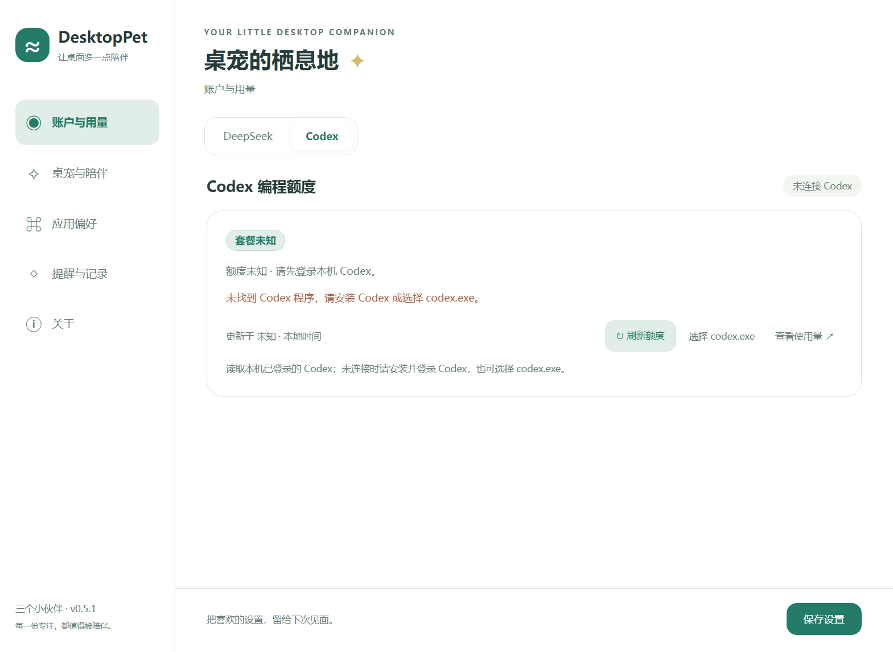
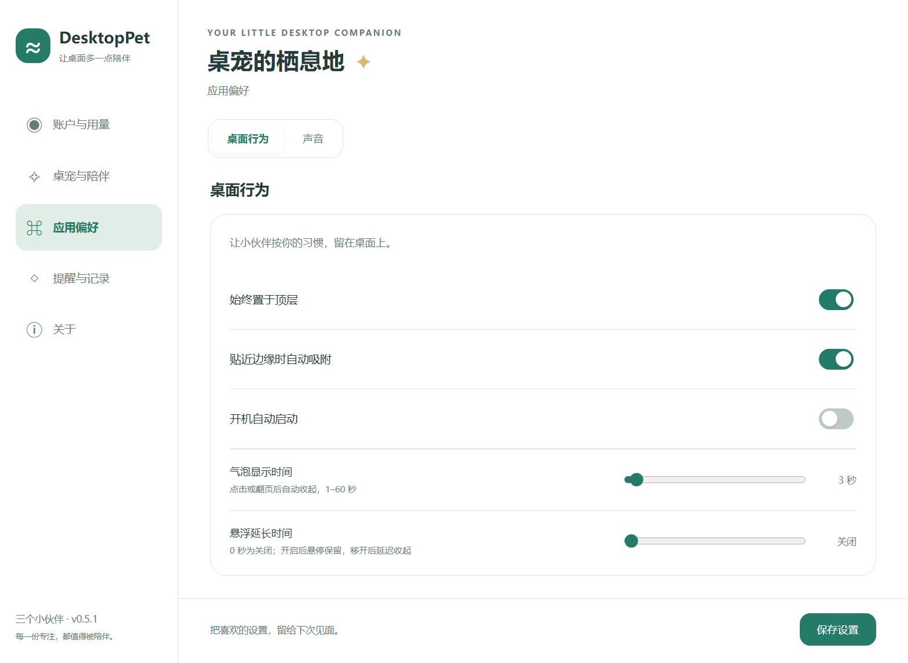
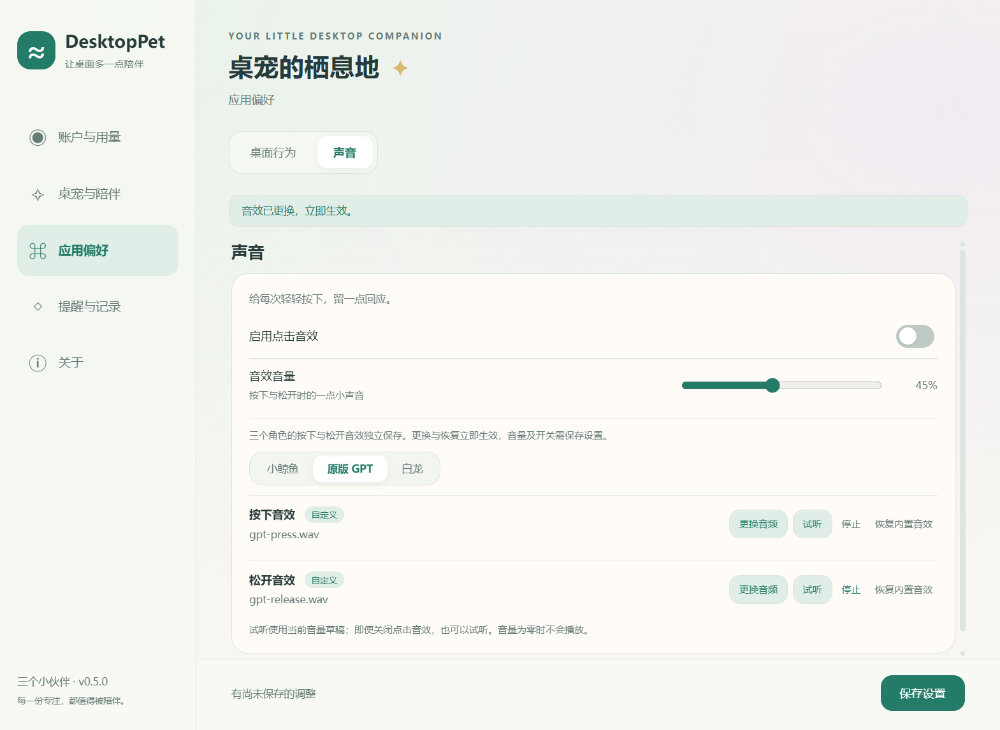
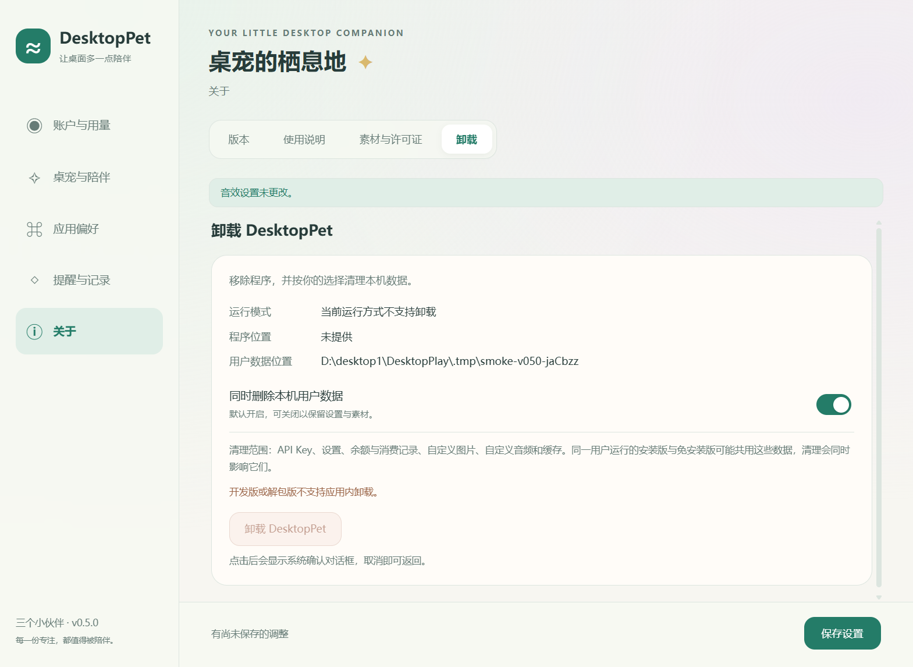
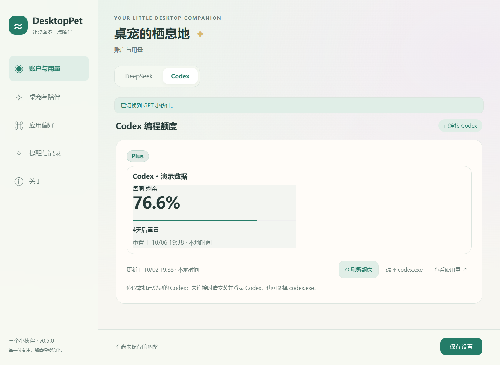
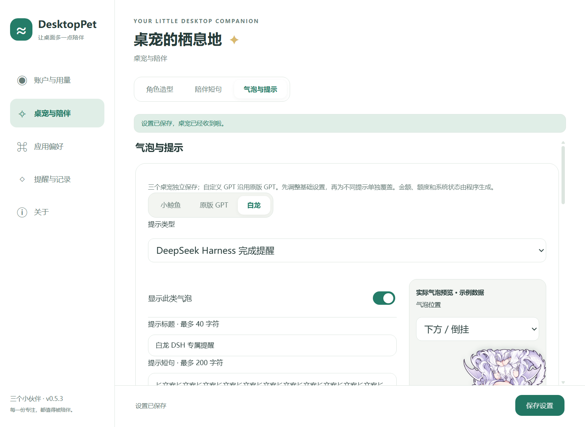

# DesktopPet

DesktopPet 是 Windows 桌面上的双角色桌宠：小鲸鱼查看 DeepSeek 余额，GPT 小伙伴查看 Codex 编程额度。GPT 角色可在原版与白龙两种内置造型间切换，也可继续使用自定义图片。面向 Windows 10/11 x64，提供 NSIS 安装版和 portable 免安装版。桌宠本身不需要 Node.js 或 DeepSeek Harness（DSH）；实时 Codex 额度需要本机已有原生 Codex 程序，并已使用 ChatGPT 账户登录。

已发布 [v1.0.0](https://github.com/Forest-Wood/DesktopPlay/releases/tag/v1.0.0)，包含三来源等待提醒、常驻对话气泡和陪伴短句展示控制。发布核实见 [T014 任务记录](docs/tasks/T014-release-v100.md)，功能实现与验证见 [T013](docs/tasks/T013-conversation-attention.md)。

## v1.0.0 新功能

- GPT Work、Codex、DeepSeek Harness 支持等待回答／审批提醒；等待及完成气泡保持到点击正文或现有关闭控件，隐藏桌宠或退出时清空。普通用量与短句气泡仍按设置自动收起。
- “提醒与记录 → 对话完成提醒”增加各来源等待开关。Codex 桌面／CLI／IDE 需勾选 hook 接入、保存，再在原客户端 `/hooks` 中信任转发项；关闭接入只移除本程序的 hook，已有配置保留并备份。Work 需开启原生提问／权限通知，DSH 支持 v4 普通／压缩日志。
- “桌宠与陪伴 → 陪伴短句”可勾选候选库、设置每轮 0–20 条及随机／顺序模式。0 关闭短句页，候选数至少等于每轮数量；顺序接着上轮实际看过的位置继续，重启从头开始。

实现、验证和限制见 [T013](docs/tasks/T013-conversation-attention.md)。本机 CLI 与 IDE 引擎已用隔离合成模型验证；真实 Work／DSH 和完整 IDE 界面试用仍需另行验证。下方保留历史版本说明。

## 桌宠与功能

- 紧凑的漫画气泡、清晰的大字额度、按压弹性动画和音效；DeepSeek 使用蓝紫配色，GPT 原版使用薄荷绿，白龙使用淡紫配色。
- 点击桌宠依次查看用量、用量总结和陪伴短句，默认 3 秒后收起；“桌宠与陪伴 → 气泡与提示”按桌宠设置时间、文案、颜色、字体及透明度，并可为各类提示单独覆盖。翻页不触发网络请求。气泡自动避开屏幕顶部。
- 桌宠左右自动朝屏幕中央；靠近屏幕工作区顶部时人物上下倒挂，文字和控件保持正向。支持拖动、四边吸附、透明区域穿透、置顶与托盘管理。
- 导入 PNG、WebP、GIF，调整大小、短句和音量；小屏幕自动限制实际尺寸。
- DeepSeek 余额自动刷新、今日已观测消费、余额增加记录、低余额和每日预算提醒。
- 本地加密保存 API Key，开机启动默认关闭。
- “关于 → 版本”检查、下载及重启更新，支持安装版和免安装版；默认启动 30 秒后、每 6 小时自动检查，可关闭自动检查。
- 设置或右键菜单切换 DeepSeek / GPT 角色并记住选择；GPT 的原版、白龙和自定义图片作为独立造型保存，切换造型不影响 Codex 额度。
- GPT 小伙伴显示 Codex 剩余百分比、额度窗口、重置时间及倒计时，支持自动和手动刷新。
- 小鲸鱼、原版 GPT、白龙分别设置按下／松开音效；支持导入音频、试听和恢复内置音效。
- 在“关于 → 卸载与数据”卸载当前安装版或当前运行的免安装版，并选择是否清理共享的本地数据。





## v1.0.0 升级说明

已正式发布：[Release 与下载](https://github.com/Forest-Wood/DesktopPlay/releases/tag/v1.0.0)。

- [Windows x64 安装版](https://github.com/Forest-Wood/DesktopPlay/releases/download/v1.0.0/DesktopPet-1.0.0-Setup-x64.exe)；[Windows x64 免安装版](https://github.com/Forest-Wood/DesktopPlay/releases/download/v1.0.0/DesktopPet-1.0.0-Portable-x64.exe)。
- v0.5.3 及以上可通过“关于 → 版本”更新；更早版本退出旧程序后直接覆盖升级，无需卸载或删除用户数据。
- 旧配置自动迁移。Codex 等待提醒默认关闭，启用接入并保存后需在原客户端完成 hook 信任；Work 需开启原生通知，DSH 支持 Windows 本机 v4。
- 公告与更新资源核实见 [v1.0.0 公告](docs/releases/v1.0.0.md) 和 [T014](docs/tasks/T014-release-v100.md)；历史版本及附件保留。

## v0.5.4 升级说明

已正式发布：[Release 与下载](https://github.com/Forest-Wood/DesktopPlay/releases/tag/v0.5.4)。

- 新增 Windows 本机 DeepSeek Harness v4 完成提醒，支持普通及 Zstandard 日志；仅提醒主会话成功完成，不补发历史。
- 全部气泡可按小鲸鱼、原版 GPT、白龙分别设置文案、时间与外观，提供分类覆盖和实际渲染预览。
- Codex、Work、DSH 完成提醒分别配置气泡、音效、音量与文件；声音默认关闭，可仅声音或仅气泡。
- v0.5.3 可使用软件内更新；更早版本可直接手动覆盖升级，无需卸载或删除数据。详情见 [v0.5.4](docs/releases/v0.5.4.md)。

## v0.5.3 升级说明

已正式发布：[Release 与下载](https://github.com/Forest-Wood/DesktopPlay/releases/tag/v0.5.3)。

- 安装版和免安装版均支持“检查更新 → 下载更新 → 重启并更新”，普通退出不会安装；保留设置、密钥、记录、素材、位置与开机启动路径。
- 更新说明、下载进度、取消和重试位于“关于 → 版本”，托盘也可进入。每个新版最多提示一次气泡，不抢焦点；完成／余额提醒优先，隐藏时不补弹。
- 免安装版在原位置校验、替换并备份；启动失败恢复旧文件。文件占用、权限或等待超时时保留旧程序，不强杀其他进程。
- **v0.5.2 及更早版本需要先手动覆盖升级到 v0.5.3 一次，无需卸载或删除数据。** 此后可在软件内更新。详情见 [v0.5.3](docs/releases/v0.5.3.md)。

## v0.5.2 升级说明

- 显示 Codex 重置卡总张数、最近已知截止日期和完整到期明细。
- 新增本机 Codex 与 ChatGPT Work 桌面对话结束气泡，支持三个角色独立编辑文案，沿用显示／悬浮时间且不抢焦点。
- 重置卡摘要增加留白并去掉横线，修复桌面分页历史与日志变化漏提醒。
- Work 需启用 ChatGPT 桌面回合结束通知，前后台都要提醒时选“始终”；该来源失败／中止也会提醒。
- 完整说明见 [v0.5.2](docs/releases/v0.5.2.md)。

## v0.5.1 升级说明

- 点击桌宠或翻页后，气泡默认显示 3 秒。设置中的“应用偏好 → 桌面行为”可将显示时间调整为 1–60 秒，将悬浮延长时间调整为 0–60 秒；0 秒表示关闭延长。开启延长时，鼠标悬停气泡会保持显示，移开后按所选秒数收起。两项随“保存设置”提交并在重启后保留。
- GPT 原版与白龙的每周重置倒计时采用更紧凑的字号与列间距，包含天、小时、分钟的完整文字保持一行。
- 应用设置页面统一使用白色背景；Windows 深色模式下也保持白色及配套的浅色控件。
- 完整说明见 [v0.5.1](docs/releases/v0.5.1.md)。



## v0.5.0 升级说明

- 沿用 `Forest-Wood/DesktopPlay` 仓库、安装身份和 `%APPDATA%\DesktopPlay` 数据目录；覆盖升级继续使用已有密钥、设置、账本、图片和位置。旧版本升级后，三个人设的六个音效槽位均使用现有内置音效。
- “应用偏好 → 声音”可为小鲸鱼、原版 GPT、白龙分别选择按下和松开音效；自定义 GPT 图片使用原版 GPT 的音效。支持 MP3、WAV、OGG，单文件不超过 5 MiB。导入后复制到用户数据目录，删除原始文件不会影响播放；无效文件不会覆盖原音效，损坏或播放失败时提示并回退内置音效。
- 更换和恢复音效立即生效；总音效开关与音量仍随“保存设置”提交。试听使用当前音量草稿，总开关关闭时也可主动试听；切换设置页面、人设或开始新的试听会停止上一段。
- GPT 主额度统一为每周在左；仅当接口实际返回 300 分钟窗口时，右侧显示 5H。缺少 5H 时隐藏右侧项目，每周保持左侧位置；缺少每周但有其他有效额度时，左侧显示“未提供”。按窗口时长识别，不依赖返回顺序或套餐名称，其他窗口和分组继续展示。刷新失败保留最近成功数据。
- “关于 → 卸载与数据”显示版本类型和当前程序位置，默认勾选“同时删除本地数据”，可取消勾选。安装版在 NSIS 卸载成功后才清理所选数据；免安装版只删除当前启动的 EXE，不删除所在文件夹。最终确认列明共享数据范围，并默认聚焦取消；卸载完成或失败由系统对话框反馈。
- 完整发行说明与验证限制见 [v0.5.0](docs/releases/v0.5.0.md)。







## v0.4.0 升级说明

- 应用由 DesktopPlay 改名为 **DesktopPet**，仓库仍为 `Forest-Wood/DesktopPlay`，数据继续保存在 `%APPDATA%\DesktopPlay`。安装版可覆盖升级，原有密钥、账本、自定义图片与位置继续使用。
- 设置使用左侧分类和页内标签：账户与用量、桌宠与陪伴、应用偏好、提醒与记录、关于。切页保留草稿，点击底部“保存设置”才会提交；角色造型、导入图片和账户连接按钮即时生效。
- 当时新增浅色／深色跟随 Windows 即时切换，v0.5.1 起统一为白色页面；内容区独立滚动。设计规范见 [DESIGN.md](DESIGN.md)。
- 小鲸鱼、原版 GPT、白龙分别保存陪伴短句。旧版本短句原样迁移到小鲸鱼；自定义 GPT 图片使用原版 GPT 的短句。
- 点击按压与人物镜像分别处理，修复左下角点击时反向的问题；白龙依据原图可见边界贴边，不修改原始 PNG。
- Codex 增加 Plus／Pro 或实际套餐名称识别，未知则明确提示；v0.5.0 的窗口排列和缺失窗口展示规则见上方升级说明。

## 简洁模式与本地时间（v1.1.0）

气泡顶部、设置的角色造型页和右键菜单可切换简洁／完整模式，所有桌宠共用并记住选择。默认完整模式；简洁模式只显示余额或剩余额度，并保留已开启的完成、提问和审批提醒。原短句、提示和音效配置保留，回到完整模式后继续使用；后台仍记录余额和消费。

DeepSeek 余额与消费记录跟随电脑时区。更换时区建立新统计分段，不计算切换前后余额差；旧记录标明原北京时间口径。峰谷标识依据 [DeepSeek 官方收费规则](https://api-docs.deepseek.com/quick_start/pricing/)，转换为电脑当地日期和时间显示，不对历史消费拆分峰谷费用。内置已核实的 2026 年中国假期表；其他年份提示“节假日待核实”。

## 获取与运行

从 [GitHub Releases](https://github.com/Forest-Wood/DesktopPlay/releases) 下载：

- `DesktopPet-<版本>-Setup-x64.exe`：交互式安装，可选择安装目录并创建桌面快捷方式。
- `DesktopPet-<版本>-Portable-x64.exe`：单文件免安装版，直接运行。

两种版本都把应用设置、加密保存的 API Key、账本、用户导入的图片和音效放在 `%APPDATA%\DesktopPlay`。Portable 版也使用这个目录；手动删除 portable exe 不会自动删除这些数据。应用内卸载默认清理共享数据，可取消勾选保留；从 Windows 设置或独立 NSIS 卸载器卸载安装版时默认保留数据，覆盖升级也不清理数据。

首次运行后，在应用设置中输入 DeepSeek API Key。密钥由 Windows 加密后保存在当前 Windows 用户的数据目录中；不要把密钥提交到仓库、截图或问题报告里。应用通过 DeepSeek API 查询余额。余额数值和用量记录是应用观测值，不是 DeepSeek 官方账单；同一账户通过其他 API Key 或客户端产生的余额变化也可能反映在这些观测值中。

新账本按电脑当前时区每天首次成功取得的余额快照建立当日基线；切换时区会开始新分段，旧记录保留原北京时间口径；该跨日首个快照不会将它与前一天的余额差计入当天。当天后续成功快照按相邻快照计算：余额下降累计为已用量，余额增加单独累计，不抵扣已用量。因此无法从两个快照还原其间同时发生的消费和充值。网络请求失败时会保留最近一次成功取得的余额，并显示错误状态，不会把失败当成余额归零。

## GPT 小伙伴与 Codex 额度

v0.5.2 包含以下功能：

- GPT 气泡显示可用重置卡张数和最近已知截止日期；账户与用量 → Codex 列出接口提供的全部明细，包含完整日期、时间与时区。总数以接口返回值为准；接口可能只提供张数或部分明细，界面会明确提示。失败时保留上次数据，不兑换重置卡。
- “提醒与记录 → 对话完成提醒”分别设置 Codex、ChatGPT Work、DeepSeek Harness 的开关、目录及监听状态。Codex 默认读取 `CODEX_HOME`，否则读取用户目录下的 `.codex`，覆盖该目录的本机桌面、CLI、IDE 会话及分页历史。
- ChatGPT Work 读取本机原生结束通知，失败或中止也提醒。请在 ChatGPT 桌面设置中开启回合结束通知，前后台都需要提醒时选“始终”（Always）；[官方通知说明](https://learn.chatgpt.com/docs/notifications)。应用抑制的通知不会触发桌宠。
- DeepSeek Harness 默认读取 `DSH_HOME/sessions`，未设置时使用 `~/.dsh/sessions`；支持选择会话目录和 v4 普通／Zstandard 压缩日志。只提醒主会话明确成功完成的轮次，未知版本显示不兼容，不改写 DSH 配置或日志。
- 小鲸鱼、原版 GPT、白龙按“桌宠 × 来源”分别编辑完成文案和音效；自定义 GPT 图片沿用原版 GPT 档案。完成音效默认关闭，气泡与声音分别开关，可仅播放声音。支持音量、试听、更换 MP3/WAV/OGG（不超过 5 MiB）及恢复内置轻提示音。音频文件操作立即生效，其余设置保存后生效。
- “桌宠与陪伴 → 气泡与提示”覆盖用量、小报告、陪伴短句、换角色挽留、余额／预算、更新及三来源完成提示。基础时间和外观可按类型覆盖，真实金额、额度、版本及系统状态保留。所有桌宠均可接收余额和预算提醒，金额条件按账户统一设置。切页保留草稿，保存并重启后保留。
- 完成提醒不切换角色、不抢焦点；同一来源密集合并，不同来源依次展示，拖拽和角色确认期间延后。隐藏时清空队列、停止声音，不补发历史。Codex、DSH 排除失败、取消及子代理；Work 跟随原生结束通知，不推测成功状态。本轮仅覆盖本机 Windows，不包含远程／WSL。



完成监听只读本地会话状态及桌面通知日志，不改写客户端配置；不会把对话正文或原生通知中的账户标识保存到 DesktopPet 或放入通知。监听状态显示在完成提醒页面，目录缺失或读取异常时自动重试。事件格式随客户端版本变化，无法识别的事件和过长单行会跳过，不凭安静时长推断完成。

Codex 分页历史通过 Node 内置 SQLite 的只读连接查询 `thread_history_*.sqlite` 的轮次状态和 `state_*.sqlite` 的会话来源，不查询正文表。两种来源按会话／轮次统一去重。数据库完成时间只有秒精度，通知使用检测时间；每次显示桌宠时先快照当前已完成轮次，避免隐藏期间的完成被补弹。数据库缺失时沿用文件监听；已有数据库不可读或结构不兼容时提示异常并重试，文件监听继续工作。

1. 在设置中选择 **GPT 小伙伴**，或右键桌宠 → **切换桌宠**。
2. 在官方 Codex CLI 或 VS Code 扩展中使用 ChatGPT 账户登录。DesktopPet 自动寻找本机 `codex.exe`；未找到时可在设置中选择已安装的原生 `codex.exe`。
3. 点击桌宠在用量、总结和陪伴短句页面间切换；使用气泡底部的刷新按钮查询额度。GPT 角色启用或设置窗口打开期间，每 60 秒自动刷新。

GPT 角色中可直接切换原版与白龙造型，或选择自定义图片。点击“换角色”后可在挽留页面确认切换，也可选择再陪一会儿；DeepSeek 与 GPT 账户角色仍可从设置或托盘菜单直接切换。

额度来自官方 Codex App Server 的 [`account/rateLimits/read`](https://learn.chatgpt.com/docs/app-server#6-rate-limits-chatgpt) 只读接口。程序按服务返回的窗口长度识别 5H、每周和其他窗口。套餐优先来自额度响应，缺失时通过 `account/read`（`refreshToken:false`）补充；仅提取套餐字段，不向界面传递邮箱或凭据。套餐查询失败不会丢弃成功取得的额度，不根据 Plus／Pro 身份推测未返回的限额。剩余百分比由 `100 - usedPercent` 计算，重置时间来自服务端 Unix 时间戳，界面按电脑本地时区显示。它不是 ChatGPT 网页对话额度，也不是 OpenAI API 余额。

气泡与设置页使用相同排列：每周固定在左，实际返回的 300 分钟窗口显示为右侧 5H。没有 5H 时不显示占位，也不将每周移到中央；没有任何有效额度时继续显示未知或连接状态。其他时长和额外额度分组位于后续区域。

离线或查询失败时保留最近成功数据并标记错误和更新时间。倒计时归零只表示到达服务上次报告的时间，需要重新查询才能确认恢复；未知窗口或重置时间显示“未知”，不会虚构余额或恢复时间。没有登录或没有安装 Codex 时，两个桌宠和 DeepSeek 功能仍可使用。

DesktopPet 通过 Codex 原生程序读取额度，不读取或复制 `auth.json`，不要求在桌宠中粘贴 ChatGPT 登录令牌，不启动对话或消耗推理额度。登录凭据仍由官方 Codex 管理。若额度失效，请在 Codex 中重新登录后刷新。

GPT 原版与白龙造型均为根据用户提供参考图生成的非官方二创形象，不是 OpenAI 官方吉祥物，也不代表 OpenAI 的认可。白龙图像可在 GPT 设置中作为内置造型使用。素材来源、制作记录与提示词见 [GPT 原版素材记录](docs/gpt-art-prompt.md) 和 [GPT 白龙素材记录](docs/gpt-dragon-v2-art-prompt.md)；具体素材权利说明见 [第三方代码与素材声明](THIRD_PARTY_NOTICES.md)。

## 从源码运行

需要 Windows 10/11 x64、Node.js 24 和 npm。克隆仓库后在项目目录执行：

```powershell
npm ci
npm run dev
```

开发与打包命令：

```powershell
npm test
npm run build
npm run test:smoke
npm run dist
```

`npm run dev` 启动 Vite 和 Electron 开发版；`npm test` 运行单元测试；`npm run build` 先做 TypeScript 类型检查，再构建界面和 Electron 主进程；`npm run test:smoke` 运行 Playwright Electron 冒烟流程，不需要额外安装浏览器；`npm run dist` 在 Windows x64 上生成 NSIS 和 portable 安装包到 `release/`。发布包不包含账本、API Key 或用户导入的图片和音效。源码开发版不提供应用内卸载。

## 项目文件与清理

`src/` 保存应用源码，`tests/` 保存测试，`scripts/` 保存开发工具；`build/` 是安装、更新与 Hook 所需的源资源，`public/` 是内置素材。文档与正式示例图片位于 `docs/`。

构建结果写入 `dist/` 和 `dist-electron/`，测试截图与报告写入 `test-results/`，临时测试配置写入 `.tmp/smoke-*`。测试不自动覆盖 `docs/` 中的示例图片；正式图片需要显式更新。`release/` 保留最近一套分发文件。

关闭项目开发／测试进程后，可执行 `npm run clean -- --dry-run` 查看清单，再执行 `npm run clean`。命令仅清理上述构建／测试产物及 `playwright-report/`、`coverage/`，会保护 Git 跟踪文件、目录链接并报告占用失败。安装包、依赖、源码、`.tmp/manual-profile/` 及其他临时目录不会被该命令删除；清理后运行 `npm run build` 恢复可启动的开发版。

小鲸鱼完整模式用量气泡在“今日已观测”金额下显示 API 峰谷状态及下次切换的电脑当地时间。悬停查看日期、时区和规则；假期范围尚未核实时提示“下次切换待核实”。该提示无需余额请求，简洁模式不显示。

## CI 与发布

推送到 `main` 或向 `main` 提交 Pull Request 时，GitHub Actions 在 Windows runner 和 Node.js 24 上执行版本计划校验、类型检查、单元测试、构建和 Electron 冒烟测试。普通分支提交不会创建 Release。

自 T019 起按变更类别命名版本：已有功能完善为 patch（0.5.4 → 0.5.5），新增功能为 minor（如 1.0.1 → 1.1.0），不论涉及多少桌宠；major 仅由用户明确决定；一次发布取最高档并清零低位。影响全部桌宠的修复仍是 patch；内部文档／构建维护不单独升版本。发布准备使用 `npm.cmd run release:prepare -- --base <上一正式版本> --types <实际类型> --notes <公告文件>`，检查用 `npm.cmd run release:check`；普通开发无需提前升版本。详细规则见[发布流程](docs/release.md)。

发布工作流核实基准仍为 GitHub 上一正式版、标签与版本一致，重新测试打包、计算摘要，核实草稿五附件完整后才转正式版。GitHub Release 与软件内“更新公告”共用简短说明，安装版和免安装版内容一致；点击桌宠更新气泡可进入版本页查看公告后下载。

## 常见问题

**启动时提示 Windows 已保护你的电脑或未知发布者？** 当前安装包仍未进行代码签名，Windows SmartScreen 可能显示警告。请只从本仓库的 Releases 下载，并在运行前核对发布页提供的 SHA-256 校验和。

**Portable 版是否把数据保存在 exe 旁边？** 否。为了让两个版本行为一致，portable 版也使用 `%APPDATA%\DesktopPlay`；将 exe 移到其他位置不会移动设置、密钥或账本。

**为什么今日已用量和官方账单不同？** 这是根据应用成功观察到的相邻余额快照计算的估算值：余额下降累计为已用量，余额增加单独累计。电脑当地日期跨日或切换时区后的首个快照建立新基线；首次快照前的变化以及同一观测间隔内同时发生的消费和充值无法准确拆分。

**余额没有更新怎么办？** 检查网络和 API Key，稍后重试。请求失败时应用保留上一次成功的余额，直到后续请求成功。

**卸载后数据还在吗？** 应用内“关于 → 卸载与数据”默认勾选清理 `%APPDATA%\DesktopPlay`，取消勾选即可保留。从 Windows 设置或独立 NSIS 卸载器卸载时默认保留数据。安装版、免安装版和其他版本共享这个目录，清理会同时删除其中的密钥、设置、账本、图片、音效和缓存；其他下载副本、源码仓库及官方 Codex 登录数据不在删除范围内。

## 许可与素材

本仓库原创代码由 Forest-Wood 按 MIT License 发布，见 [LICENSE](LICENSE)。部分实现参考 MeteorNOX 的 [DeepSeek-Balance-Whale-Widget](https://github.com/MeteorNOX/DeepSeek-Balance-Whale-Widget)，保留其 MIT 许可证全文和来源说明，见 [THIRD_PARTY_NOTICES.md](THIRD_PARTY_NOTICES.md)。

鲸鱼图片与音效来自该上游仓库 commit [`49d688d46673fbf4221b458afc943276c68a0839`](https://github.com/MeteorNOX/DeepSeek-Balance-Whale-Widget/tree/49d688d46673fbf4221b458afc943276c68a0839) 的 `assets/DSniang1.png`、`assets/Ya1.mp3`、`assets/Ya2.mp3`，在本项目中分别重命名为 `whale.png`、`press.mp3`、`release.mp3`。它们不属于本仓库代码的 MIT 授权范围，也不宣称为 MIT 素材。来源记录见该版本的上游 [PROVENANCE.md](https://github.com/MeteorNOX/DeepSeek-Balance-Whale-Widget/blob/49d688d46673fbf4221b458afc943276c68a0839/PROVENANCE.md)。
