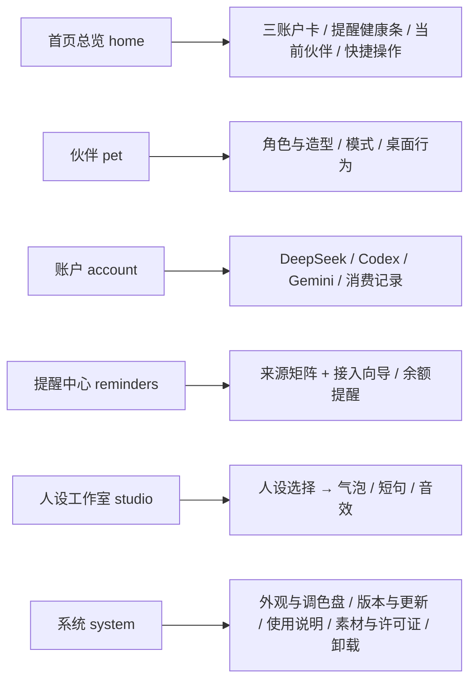

# DesktopPet 前端重设计与超级调色盘规格（R041／R042）

- 日期：2026-11-20（Asia/Shanghai）。规划任务：[T034](tasks/T034-ui-redesign-plan.md)。
- 状态：分阶段实现。[T035](tasks/T035-ui-foundation.md) 已实现六项导航和共用界面，[T036](tasks/T036-home-overview.md) 已实现首页总览，[T037](tasks/T037-reminder-center.md) 已实现提醒中心。本文件记录 T035–T041 的共同设计，具体实现和验收见各任务记录。
- 交互原型（虚构数据、仅作视觉参考，不进入构建）：[docs/previews/T034/ui-mockup.html](previews/T034/ui-mockup.html)。
- 现行界面规范仍以 [DESIGN.md](../DESIGN.md) 为准；各 PR 合并时把已落地的部分迁移进 DESIGN.md，并删除本文中对应的"规划"描述，避免两处长期重复。

## 1. 已确认的用户决定（2026-11-20）

| # | 问题 | 决定 |
| --- | --- | --- |
| D1 | 改造范围 | 设置窗口与桌宠气泡**同时升级** |
| D2 | 导航结构 | 采用 **6 项新导航**：首页总览、伙伴、账户、提醒中心、人设工作室、系统 |
| D3 | 视觉风格 | **沿用当前**白底＋鼠尾草侧栏＋松绿主色的安静风格；**新增主题色自定义**，参考腾讯 QQ（QQNT）"超级调色盘" |
| D4 | 交付节奏 | **拆分为多个合理 PR**，每个 PR 独立可合并、可验证 |

## 2. 现状问题

| # | 问题 | 定位 |
| --- | --- | --- |
| P1 | 缺少总览：三个账户分散在 3 个子页，一次只能看到一个 | `src/renderer/settings.ts` 中 `pages` 的 `account` 分类 |
| P2 | 提醒配置分散：4 个来源 × 完成／等待 × 目录／Hook，状态全靠文字，看不出哪条链路已接通 | `completion` 子页的 `integration-card` 是把旧 DOM 搬移拼接而成 |
| P3 | 同一人设的配置分布在三页：气泡、短句、音效 | `bubbles`／`companionship`／`sound` |
| P4 | 15 类气泡场景挤在一个下拉框；预览位于长表单下方 | `src/renderer/bubble-editor.ts` |
| P5 | 说明文字（`.hint`）过多，关键状态被淹没 | 全局 |
| P6 | 桌宠气泡底部有 4 个按钮，偏拥挤；`1/5` 页码不够直观 | `src/renderer/pet.ts` |
| P7 | 无法看出哪一页有未保存的草稿 | `.save-bar` |
| P8 | 主题色写死在 CSS 中，用户无法个性化 | `settings.css`、`settings-workspace.css`、`styles.css` |

## 3. 设计原则

1. **先看状态，再做设置**：首页一屏汇总 3 个账户和 4 个提醒来源的健康状况。
2. **导航与功能分支一一对应**：6 个入口分别对应项目的 6 个功能分支。
3. **人设集中编辑**：气泡、短句、音效按当前人设集中编辑，并始终配有实时预览。
4. **状态用图形表达，文字作补充**：状态点和颜色旁边必须保留文字，满足现有可访问性要求。
5. **说明默认折叠**：每页只保留一句主说明，其余放进 `<details>` 或"？"提示。
6. **风格可调但有边界**：主题色可以自定义，但对比度、状态色和品牌底色受保护，避免用户调出看不清的界面。

## 4. 信息架构



### 4.1 新旧映射

| 原分类 → 子页（section id） | 新导航 → 子页 | 说明 |
| --- | --- | --- |
| —— | **首页总览** → `home` | 新增 |
| 我的桌宠 → 角色与模式 `appearance`、桌面行为 `behavior` | **伙伴** → `appearance`、`behavior` | 保留 section id |
| 账户与用量 → `overview`、`codex`、`gemini`、`records` | **账户** → 同名 | 保留 section id |
| 提醒与声音 → 对话提醒 `completion`、余额提醒 `reminders` | **提醒中心** → `completion`、`reminders` | `completion` 改为矩阵布局 |
| 我的桌宠 → 陪伴短句 `companionship` | **人设工作室** → `companionship` | 嵌入工作室 |
| 气泡与文案 → `bubbles` | **人设工作室** → `bubbles` | 嵌入工作室 |
| 提醒与声音 → 声音 `sound` | **人设工作室** → `sound`；总开关与总音量放在工作室顶部 | 嵌入工作室 |
| —— | **系统** → `palette`（外观与调色盘） | 新增，见第 7 节 |
| 关于 → `version`、`guide`、`licenses`、`uninstall` | **系统** → 同名 | 保留 section id |

- 默认打开**首页**。原来"初次打开显示当前角色对应的账户页"的规则改为：首页上当前角色对应的账户卡高亮显示。
- `onSettingsPage('version')` 和托盘的"检查更新"入口不变，直接定位到"系统 → 版本与更新"。
- 现有 `data-settings-page` 快捷跳转统一迁到新的路由函数；键盘焦点移动规则保持不变。

## 5. 设置窗口各页规格

窗口约束不变：默认 1060×800、最小 760×560；内容区是唯一的滚动区；底部保存栏固定。

### 5.1 首页总览 `home`（新增）
- **问候条**：根据时段显示问候语，并汇总状态，例如"3 个账户正常 · 1 个提醒来源待完成接入"，可点击跳转。右侧快捷操作：刷新全部（依次调用 `refreshBalance`、`refreshCodexQuota`、`refreshGeminiQuota`，任一失败不影响其余）、简洁／完整模式切换（即时生效，与气泡顶部按钮行为一致）、检查更新。
- **账户卡**（`auto-fit, minmax(230px, 1fr)` 网格，窄窗口自动变成单列）：
  - DeepSeek：显示余额（大号等宽数字）、今日已观测金额、最近 7 个日分段的迷你柱状图（取自 `ledger.history`，数据不足 7 天时只画已有天数，不补零）、峰谷标签（复用 `deepseekPeriod`）。
  - Codex：每周窗口和 5H 窗口各一个环形进度（窗口识别规则与现有 `renderQuota` 一致：每周在左，只有存在 300 分钟窗口时才显示 5H 环，不显示占位）。另显示套餐标签、重置倒计时、重置卡张数。
  - Gemini：复用 `renderGeminiQuota` 的三个额度窗口。共享池显示“与 Gemini 共用”，缺失时显示“未提供”。套餐标签读取额度响应明确提供的名称，缺少时显示“套餐未提供”。
  - 右上角状态胶囊共 5 种：正常／刷新中／异常（展示最近数据）／未连接／演示。点击整张卡片进入对应的账户子页。
  - **空状态**：显示主按钮，替代原来的红色错误文字。DeepSeek 显示"添加 API Key"，Codex 显示"选择 codex.exe"，Gemini 显示"打开 Antigravity 或登录 agy"（只给提示，不代用户启动）。
- **提醒健康条**：4 个小块，各显示来源名、`完成 ●／等待 ●` 两个开关状态、健康色（规则见 5.4）、最近事件时间（有 `lastAttentionAt` 时显示）。点击跳到提醒中心并展开该来源的行。
- **当前伙伴卡**：显示当前角色舞台，带"换角色"和"换造型"入口（调用已有 IPC）。

### 5.2 伙伴（`appearance`、`behavior`）
- 3 个角色以大卡片并排展示（角色名分别为 Deepseek、GPT、Gemini）；选中的卡片用该人设的主题色描边，并标注"已选"文字。“小鲸鱼”、“原版 GPT”、“白龙”（及 Gemini 默认昵称）作为**可自定义修改的昵称**展示，卡片内提供内联编辑入口（空值回退默认昵称；持久化设置需提供默认值、主进程校验与旧配置读取兼容）。造型缩略图条放在卡片下方（GPT：原版／白龙／自定义；Gemini：经典／手绘）。
- 模式选择改为两张示意卡（完整／简洁），对应原来的 `#pet-mode`。原 `select` 保留为视觉隐藏的表单控件，或改为 radio 组但保持相同的 `name="petMode"`。
- 角色大小、置顶、吸附、开机启动合并到"桌面行为"卡中。

### 5.3 账户（`overview`、`codex`、`gemini`、`records`）
- 每页统一为三段结构：**指标卡 → 操作区 → 折叠说明**。保留现有控件 id：`api-key`、`refresh`、`codex-quotas`、`gemini-quotas` 等。
- 消费记录在表格上方加一张按日柱状图（使用纯 CSS 或 SVG，不引入图表库）；表格默认显示最近 14 行，可以展开查看全部。

### 5.4 提醒中心（`completion`、`reminders`）
- **来源矩阵**：每个来源一行（Gemini · Antigravity／Codex／ChatGPT App／DeepSeek Harness）。列依次为：完成开关、等待回应开关、接入方式、实时状态、完成音效（"试听"按钮和"编辑 ↗"链接，跳到人设工作室中对应的场景）。
- **健康色规则**（完全由现有 `AppState` 推导，不新增字段）：

| 色 | 含义 | 判定（按优先级） |
| --- | --- | --- |
| 灰 `--off` | 已关闭 | 该来源的完成开关与等待开关都关闭 |
| 红 `--err` | 异常 | 对应 `*Completion.status === 'error'`，或 Gemini 状态文本包含冲突／不可写 |
| 琥珀 `--warn` | 需要操作 | 已开启但 `status === 'unavailable'`；或 Codex 已启用 Hook、`codexAttention` 尚未收到事件；或存在未保存的接入草稿 |
| 绿 `--ok` | 已收到事件 | 当前监听范围内存在 `lastAttentionAt` |
| 蓝 `--info` | 监听中 | `status` 为 `watching` 或 `starting` |

- **接入向导**：点击某行展开，把原来的目录选择、Hook 开关、信任说明改成步骤条，每一步标注"已完成／待完成"（可推导的步骤自动打勾，无法推导的步骤只显示说明，不虚构状态）。保留原有控件 id：`completion-enabled`、`completion-directory`、`dsh-directory`、`codex-attention-status` 等。
- **余额提醒**放在矩阵下方，“余额提醒”标签也可打开同一张卡片。两处共用 `low-balance`、`daily-budget` 和草稿。

### 5.5 人设工作室（`bubbles`、`companionship`、`sound`）
- **顶部人设条**：Deepseek（原小鲸鱼）、GPT（合并原版 GPT 与白龙）、Gemini 三个头像（使用真实素材缩略图），选中的头像使用该人设的主题色。三个子页**共用同一个当前人设**，取代原来 `persona-tabs`、`data-sound-persona`、`data-bubble-persona` 三套各自独立的选择器。
- **二级标签**：气泡 · 短句 · 音效。
- **气泡子页**采用三栏布局，宽度不足时依次降级：
  - 左栏是**分组场景列表**，取代 `#bubble-scenario` 下拉框。原下拉框保留为视觉隐藏，作为兼容层，以便现有 smoke 测试继续使用 `selectOption`。分组为：基础样式／数据页（用量、小报告、短句、挽留）／系统提示（低余额、预算、更新）／对话提醒（4 个来源的完成，以及 4 个来源的等待回应）。存在 style 或 timing 覆盖的条目旁显示覆盖圆点。
  - 中栏是编辑表单，沿用现有字段和 id。
  - 右栏是 `position: sticky` 的**实时预览**（继续复用 `mountPet`）。
  - 宽度低于 980px 时变为两栏（预览移到表单上方）；低于 760px 时变为单栏。
- **短句子页**：左边是可勾选的列表，右边设置 N 与播放模式（`phrase-count`、`phrase-mode`），并显示预览。
- **音效子页**：6 个槽位排成网格（按下、松开、4 个来源的完成音），每格提供"试听／更换／恢复"。完成音效的开关和音量仍归属气泡规则（`BubbleRule.soundEnabled/volume`），音效格中显示"在气泡中设置 ↗"。

### 5.6 系统（`palette`、`version`、`guide`、`licenses`、`uninstall`）
- `palette`：外观与超级调色盘，见第 7 节。
- 版本页改为版本卡：显示"当前版本 → 最新版本"、进度条、速率和 ETA（复用 `formatUpdateDownloadDetail`）、公告。
- 卸载页设为"危险操作区"，用红色描边，流程不变。

### 5.7 跨页交互
- **草稿指示**：有未保存修改的导航项显示琥珀色圆点。保存栏显示"N 项未保存 · 放弃修改 · 保存设置"。"放弃修改"把草稿恢复为最近一次 `AppState.settings`。即时生效的操作（角色、造型、导入、账户等）不计入草稿。
- 统一由 `navigate(category, page, focusTarget?)` 负责路由和焦点移动；首页卡片、健康条、"编辑 ↗"链接都调用它。
- `prefers-reduced-motion`、3px 焦点描边、tab／tabpanel 语义继续保留；二级标签继续支持左右方向键、Home、End。

## 6. 桌宠气泡升级规格

**不变约束**：气泡尺寸（192 DIP 高）、`pet-layout.ts` 中的命中区域、倒挂与镜像规则、优先级队列、常驻／定时关闭语义、简洁模式过滤规则一律保持不变。

| 项 | 现状 | 新方案 |
| --- | --- | --- |
| 页码 | `1/5` 文本 | 页码点 `● ○ ○`，`aria-label` 保留"第 1 页，共 5 页"；页数超过 7 时退回文本显示 |
| 底部按钮 | 刷新、换角色、换造型、设置 | 只保留 **刷新** 和 **⋯ 更多**。"更多"展开的二级菜单在气泡上方以**上层浮层遮盖展示**（带轻磨砂遮罩，不挤占气泡内部文字排版），包括：换角色（仍走挽留确认）、换造型、简洁／完整模式、设置；使用 DOM 实现，不调用原生菜单，保证键盘可达 |
| 模式按钮 | 位于顶部 | 移入"更多"；顶部只保留标题、页码点和关闭按钮 |
| GPT 用量 | 两组大号百分比 | 两个迷你环形进度，百分比文字放在环中间；倒计时完整单行显示（R003 约束继续有效） |
| Gemini 用量 | 双列布局 | 保持双列布局，同步新的主题变量，并**增加订阅方案展示**（如 AI Pro 标签） |
| DeepSeek 用量 | 大号余额＋峰谷 | 保持现状，峰谷改为胶囊样式 |
| 对话提醒 | 只有文字 | 左上角显示**来源标签**（Codex／ChatGPT／DSH／Gemini）；等待回应使用琥珀色描边和外圈，完成提醒沿用人设色 |
| 主题 | 写死的 `gpt-theme`／`dragon-theme`／`gemini-theme` | 改由调色盘生成的 CSS 变量驱动（第 7 节）；原有 class 保留作为默认值 |

用户在气泡编辑器中设置的 `BubbleStyle` 优先级**高于**调色盘派生色（见 7.4）。

## 7. 超级调色盘（主题色自定义，R042）

### 7.1 参考调研（QQ／QQNT"超级调色盘"）

公开资料（IT 之家、游民星空、天极网等 2025 年报道，以及腾讯 QQ 官方页面的检索摘要；未逐一核实原文，细节以 QQ 客户端实际表现为准）显示：

- 入口位于 QQ"设置 → 外观设置 → 切换色彩主题"，属于"超级调色盘"页面；该功能已对普通用户免费开放。
- 提供两种模式：一是**官方预设配色**，一键套用；二是**"随心调"／自由搭配**，可分别调整整体主题色、窗口边框、聊天气泡颜色、聊天背景和纹理。
- 自定义背景支持调整透明度和模糊度，保证文字可读；部分版本会根据背景图推荐协调的色调。
- 可以配合"经典模式／效率模式"等不同面板形态使用。

**本项目借鉴与取舍**：

| QQ 能力 | DesktopPet 映射 | 本期 |
| --- | --- | --- |
| 预设配色一键套用 | 8 套"预设色卡"（含默认松绿） | ✅ |
| 随心调主题色 | 主色取色器（色相环或 HEX），自动派生整套色阶 | ✅ |
| 分区独立调色（边框／气泡／背景） | 4 个可单独覆盖的槽位：主色、侧栏、角色舞台、桌宠气泡 | ✅ |
| 纹理 | 侧栏与舞台的轻纹理：无／点阵／细格／星光，使用 CSS 生成，不引入图片 | ✅ |
| 背景图推荐配色 | **从当前角色图片取色**（提取 3–5 个候选主色） | ✅ |
| 自定义背景图（透明度、模糊） | 设置窗口背景图 | ❌ 暂不做，与"安静白底"风格冲突；以后可另立需求 |
| 深色主题 | —— | ❌ 本期仍固定浅色（`color-scheme: light`） |
| 主题分享 | "主题码"复制／粘贴（Base64 JSON） | ⭕ 可选，放在 T040 末尾，时间不够时可延后 |

### 7.2 界面（系统 → 外观与调色盘）

```text
┌ 预设色卡 ─────────────────────────────────────────────┐
│ ● 松绿(默认) ● 薄荷 ● 海盐蓝 ● 星光紫 ● 樱粉 ● 暖杏 ● 墨灰 ● 跟随角色 │
├ 随心调 ───────────────────────┬ 实时预览 ──────────────┤
│ 主色   [色相环] [#28624f] [取色自角色] │ 迷你设置窗口：侧栏+按钮+卡片 │
│ 分区覆盖  ☐侧栏  ☐角色舞台  ☐桌宠气泡     │ 迷你桌宠气泡（当前人设）      │
│ 纹理   ○无 ○点阵 ○细格 ○星光              │ 对比度：AA ✓ 4.8:1            │
│ 强度   ───●──── 柔和 ↔ 鲜明                │                               │
├ 应用范围 ────────────────────────────────────────────┤
│ ☑ 设置窗口   ☑ 桌宠气泡（未自定义样式的人设）  [恢复默认] [主题码] │
└──────────────────────────────────────────────────────┘
```

- "跟随角色"：主色随当前人设变化，直接使用 `bubble-settings.ts` 中各人设现有的 palette。
- 改动在设置窗口内**即时预览**，但遵循现有草稿模型：点击"保存设置"后才会持久化并广播给桌宠窗口；"放弃修改"会恢复原样。

### 7.3 数据模型（新增设置字段）

```ts
// src/shared/types.ts（规划，未实现）
export type ThemePresetId = 'sage' | 'mint' | 'sea' | 'starlight' | 'sakura' | 'apricot' | 'ink' | 'persona';
export type ThemeTexture = 'none' | 'dots' | 'grid' | 'stars';
export interface ThemeSettings {
  preset: ThemePresetId | 'custom';
  accent: string;                // #rrggbb，preset 不为 custom 时等于预设值
  overrides: Partial<Record<'sidebar' | 'stage' | 'bubble', string>>; // #rrggbb
  texture: ThemeTexture;
  intensity: number;             // 0.6–1.4，控制派生色的饱和度和明度跨度
  applyToSettings: boolean;
  applyToPet: boolean;
}
// AppSettings 新增：theme: ThemeSettings
```

- **默认值**：`{ preset: 'sage', accent: '#28624f', overrides: {}, texture: 'none', intensity: 1, applyToSettings: true, applyToPet: false }`。
  - `applyToPet` 默认为 **false**，保证升级后桌宠外观和旧版完全一致。
- **主进程校验**（`desktop-service.ts`）：字段白名单；颜色必须匹配 `/^#[0-9a-f]{6}$/i`；`intensity` 取值范围 0.6–1.4；`preset` 和 `texture` 必须是枚举值；未知或危险键整体拒绝，并保留原设置（与现有 `settings()` 风格一致）。
- **兼容性**：旧配置缺少 `theme` 时补默认值；本地设置版本号仍为 1；不保证旧版程序能读取新字段（与 DESIGN.md 现有约定一致）。
- **IPC**：继续通过已有的 `updateSettings` 和 `getState`，**不新增通道**。仍需同步 `types.ts`、`defaults.ts`、主进程校验、preload 类型（无需改代码）、renderer 和 `demo.ts`。
- **"从角色取色"**：在渲染层用 `<canvas>` 读取当前 `pet.url`。**待确认**：自定义图片的 URL 形式是否会污染 canvas。若不可行，改为在主进程用 `nativeImage` 降采样后返回候选色；这需要新增一个只读 IPC，届时按 AGENTS 规定说明影响后再做。

### 7.4 色彩派生算法（`src/shared/theme.ts`，纯函数，可单元测试）

1. 把 `accent` 转为 OKLCH。
2. 生成色阶：`accent`、`accent-strong`（L −8%）、`accent-soft`（L 94–96%、C ×0.25）、`selected`（L 92%）、`nav`（L 97%、C ×0.12）、`stage-tint`、`stage-ring`、`line`（L 90%、C ×0.08）。`intensity` 按比例缩放 C 值和 L 的跨度。
3. **对比度保护**：主按钮文字和 `accent` 的对比度至少 4.5:1，正文 `--ink` 和派生表面的对比度至少 4.5:1，不达标时自动调整 L 值。预览中显示 AA ✓／✗ 和比值。达不到时禁止保存，并提示"颜色过浅，已自动加深"。
4. **状态色不参与派生**：`--ok`、`--info`、`--warn`、`--err`、`--off` 固定不变，避免语义混淆。
5. **桌宠气泡合成优先级**：用户在气泡编辑器中显式设置的 `BubbleStyle`（基础样式或场景覆盖）＞调色盘派生色（仅当 `applyToPet` 为 true，且该人设的基础样式仍等于出厂默认值时生效）＞人设出厂色。
   - 实现方式：调色盘**不改写** `bubbleProfilesByPersona`，只在 `resolveBubble` 之后的展示层合成颜色。这样关闭调色盘即可完全恢复，也不会污染持久化的气泡配置。
6. 输出为 CSS 变量对象。设置窗口写到 `:root`；桌宠写到 `.pet-canvas`。主题变化时只替换变量，不重建 DOM。

### 7.5 预设色卡（初稿，实现时以对比度校验结果为准微调）

| id | 名称 | accent |
| --- | --- | --- |
| sage | 松绿（默认） | `#28624f` |
| mint | 薄荷 | `#2f7d6d` |
| sea | 海盐蓝 | `#3a5f9e` |
| starlight | 星光紫 | `#6b4f99` |
| sakura | 樱粉 | `#a4486a` |
| apricot | 暖杏 | `#9a5b23` |
| ink | 墨灰 | `#3d4a52` |
| persona | 跟随角色 | 当前人设 palette 的 `border` 色 |

## 8. 视觉 token（重构后统一来源）

- 新建 `src/renderer/tokens.css`，承载全部设计变量；`settings.css`、`settings-workspace.css`、`styles.css`、`quota.css` 只引用变量，不再写死颜色。
- 基础 token 沿用 DESIGN.md 现值：`--surface #fff`、`--nav #f7f9f5`、`--ink #243e37`、`--muted #68776f`、`--accent #28624f`、`--selected #e8f0e9`、`--line #e0e7e1`。
- 新增 token：`--accent-strong`、`--accent-soft`、`--stage-tint`、`--stage-ring`、`--texture`，以及状态色 `--ok #2f8a5b`、`--info #3c6fb4`、`--warn #b7791f`、`--err #b4483a`、`--off #9aa59f`，人设色 `--persona-{whale,gpt,dragon,gemini}` 取自 `bubble-settings.ts` 中的 palette。
- 通用组件（纯 DOM 工厂函数，放在 `src/renderer/ui/`）：`card`、`statusChip`、`ring`、`bar`、`sparkBars`、`switchRow`、`stepList`、`segmented`、`personaPicker`。每个组件只输出带 class 的 DOM，不负责状态管理。

## 9. 代码结构规划

```text
src/renderer/
  settings.ts              # 入口 mountSettings：状态、草稿、保存、路由（逐步瘦身）
  settings/router.ts       # 6 项导航、子页、草稿圆点、navigate()
  settings/views/home.ts
  settings/views/pet.ts
  settings/views/account.ts
  settings/views/reminders.ts
  settings/views/studio.ts   # 内部复用 bubble-editor.ts
  settings/views/system.ts   # 含 palette 页
  ui/*.ts                  # 通用组件
  tokens.css
  pet.ts / bubble-pages.ts # 气泡升级
src/shared/
  theme.ts                 # 调色盘派生与校验（纯函数）
  reminder-health.ts       # 提醒健康色推导（纯函数）
```

拆分原则：每个 PR 只迁移它负责的页面；`settings.ts` 中尚未迁移的部分保持原样运行，不做一次性的大重写。

## 10. PR 拆分计划

每个任务使用独立分支，以表中上一任务分支的结果提交为起点。当前没有上一任务分支时，从已核实的 `main` 基线创建。表中的依赖列描述功能依赖。PR 按任务顺序审查和合入 `main`。

| 顺序 | 任务 | 分支（建议） | 范围 | 依赖 | 主要验收 |
| --- | --- | --- | --- | --- | --- |
| 0 | **[T034](tasks/T034-ui-redesign-plan.md)** | `docs/T034-ui-redesign-plan` | 本规划文档、需求 R041／R042、任务记录、原型与 T035–T041 待开发任务单 | — | 文档链接与范围检查、`git diff --check` |
| 1 | **[T035](tasks/T035-ui-foundation.md)** | `feat/T035-settings-foundation` | `tokens.css`、`ui/` 组件、`settings/router.ts`、6 项导航骨架（旧页面按 4.1 节挂到新分类下）、草稿圆点与"放弃修改" | T034 | 所有原 section id 可达；typecheck、单测、build；smoke 全量通过（只调整导航相关选择器）；1060×800 与 760×560 两种尺寸截图 |
| 2 | **[T036](tasks/T036-home-overview.md)** | `feat/T036-home-overview` | 首页总览、`reminder-health.ts`、刷新全部 | T035 | 健康色推导单测；首页隔离 smoke（演示数据和 `DESKTOPPLAY_TEST_NO_CODEX=1`）；空状态截图 |
| 3 | **[T037](tasks/T037-reminder-center.md)** | `feat/T037-reminder-center` | 提醒中心矩阵、接入向导、余额提醒卡 | T036 | 现有 completion、attention 相关 smoke 通过；向导步骤推导单测 |
| 4 | **[T038](tasks/T038-persona-studio.md)** | `feat/T038-persona-studio` | 人设工作室（合并为 Deepseek / GPT / Gemini 统一人设条，嵌入气泡三栏、短句、音效）；伙伴页（含可编辑昵称）、账户页、系统页的视觉统一 | T035 | 气泡、短句、音效、昵称相关单测与 smoke 通过；草稿保存与恢复；预览不裁切 |
| 5 | **[T039](tasks/T039-pet-bubble-refresh.md)** | `feat/T039-pet-bubble-refresh` | 桌宠气泡升级（第 6 节，含 Gemini 订阅方案与气泡上方遮盖“更多”浮层） | T035 | 192 DIP 不裁切；命中区域不变；倒挂、镜像、简洁模式截图；`pet-mode`、`gemini`、`reset-cards` 相关 smoke 通过 |
| 6 | **[T040](tasks/T040-super-palette.md)** | `feat/T040-super-palette` | `theme.ts`、新增 `theme` 设置字段、调色盘页、设置窗口与桌宠应用、从角色取色、可选主题码 | T038、T039 | 派生、对比度、校验、旧配置补默认值的单测；保存、重启、恢复默认的 smoke；`applyToPet=false` 时桌宠与旧版像素一致 |
| 7 | **[T041](tasks/T041-ui-redesign-handoff.md)** | `docs/T041-ui-redesign-handoff` | 把已落地的内容迁入 DESIGN.md，更新 README 截图与 `docs/previews/`，删除本文已过时的部分 | T040 | 文档一致性检查 |

- 每个功能 PR 都要更新自己的任务记录和 `PROJECT_STATE.md`，并执行 `T(N-2)` 临时文件滚动清理。
- 是否发版、发什么版本号由用户决定。按版本规则，T040 新增的调色盘属于**新增功能（minor）**；T035–T039 属于对已有功能的完善（patch）。如果合在一起发布，取最高档，即 minor。

## 11. 测试策略

遵守 AGENTS.md 中"避免过度防御性测试"的原则：

- **单元测试**（Vitest）：`theme.ts`（派生、对比度修正、非法输入）、`reminder-health.ts`（5 种健康色的优先级）、`desktop-service` 中 `theme` 字段的校验与旧配置兼容、页码点与 `aria-label`。不做像素级 CSS 断言。
- **Smoke**（Playwright Electron）：每个 PR 保留少量有代表性的端到端路径，例如导航可达、首页渲染、矩阵开关保存、工作室切人设、气泡更多菜单、调色盘保存后重启仍生效。不把单测已覆盖的组合矩阵（全部人设 × 全部场景）搬进 smoke。
- **选择器兼容**：优先保留第 4.1 节列出的 section id，以及现有 smoke 用到的控件 id（如 `save-settings`、`api-key`、`bubble-scenario`、`phrase-count`、`sound-choose-press`、`pet-mode`、`select-gpt`、`companion-shortcut`、`tab-*`）。导航结构变化后，`tab-*` 的归属会改变，需要在 T035 中统一调整 smoke 的导航辅助函数，避免逐个用例修改。
- **视觉核对**：每个 UI PR 在 1060×800 和 760×560 下截图，存入 `test-results/`（不提交）；需要进入 README 的正式截图在 T041 中显式更新。
- **隔离要求**：所有测试使用 `DESKTOPPLAY_USER_DATA` 与 `DESKTOPPLAY_TEST_NO_CODEX=1`，不访问真实账户。

## 12. 风险与待确认

| 项 | 说明 | 处理 |
| --- | --- | --- |
| 自定义图片取色 | canvas 可能被污染，读不到像素 | T040 开始前先验证；不可行时改走只读 IPC，并先说明影响 |
| 首页刷新全部 | 3 个刷新同时发起，状态广播较多 | 依次调用，并复用现有 `run` 的票据保护 |
| smoke 选择器迁移 | 导航变化后 `tab-*` 归属改变 | T035 集中调整导航辅助函数 |
| 气泡"更多"菜单 | 弹出层要放在 192 DIP 气泡内，不改命中区域 | 菜单在气泡内绘制并覆盖正文区域，不溢出到气泡外 |
| QQ 资料准确性 | 调研来自检索摘要 | 只作为交互参考，不复制 QQ 的视觉和命名，不涉及其素材 |
| 原生鼠标间歇偏移 | 既有未解决问题（T010／T014／T022） | 本系列不处理，也不得让它恶化 |
