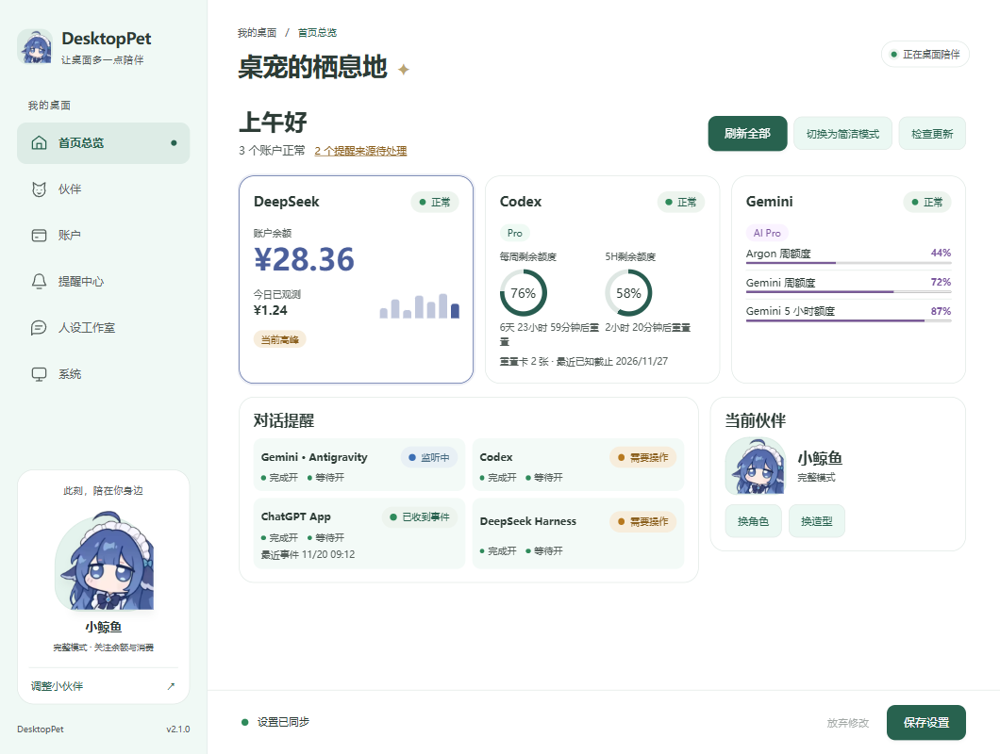
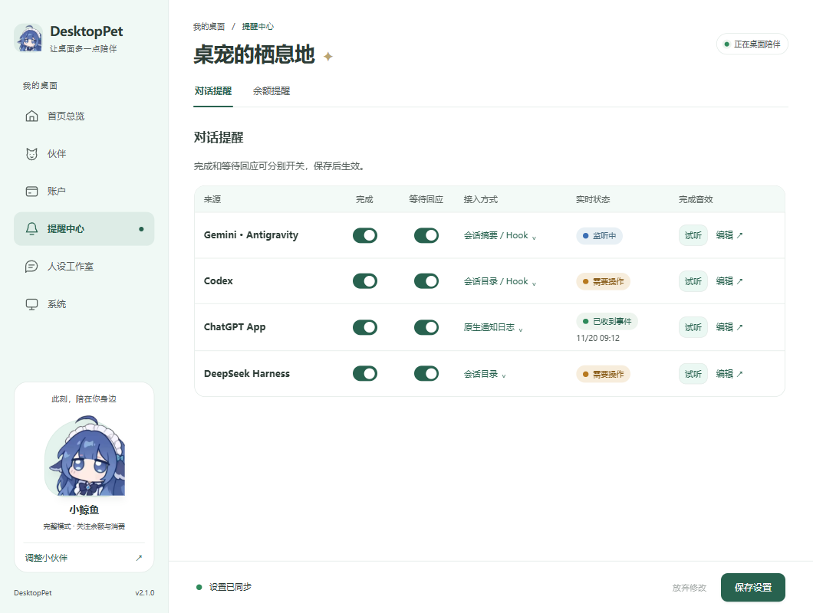
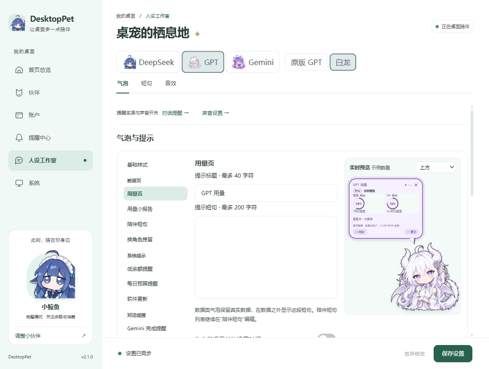
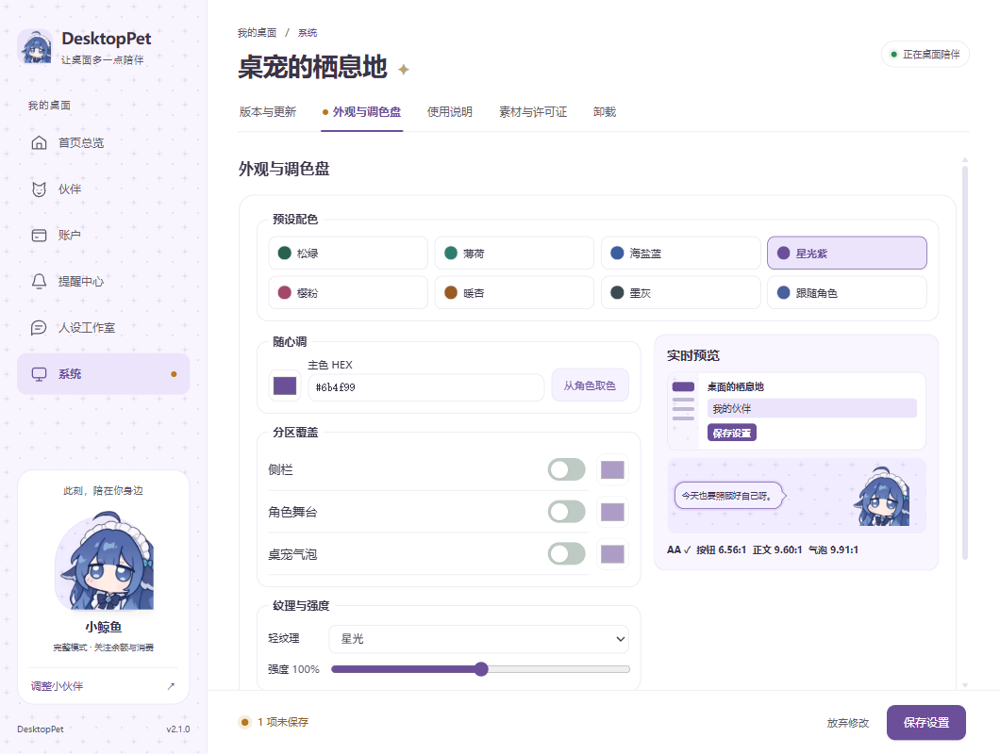
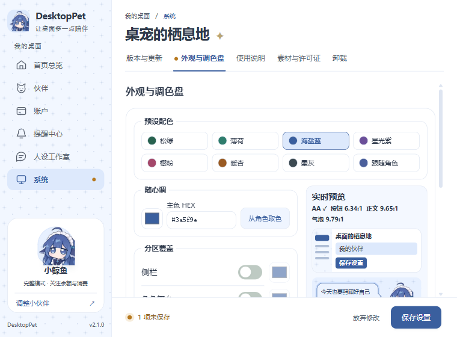
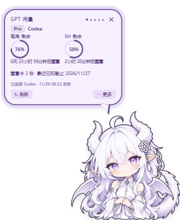
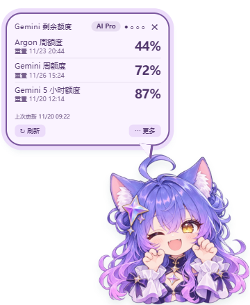

# DesktopPet 正式界面预览（T041）

以下 8 张实拍截图均在隔离 Electron 环境（`DESKTOPPLAY_USER_DATA`、`DESKTOPPLAY_TEST_NO_CODEX=1`）下使用虚构演示数据生成，不包含真实 API Key、账户标识、账本或本地客户端路径。完整界面与数据契约见 [DESIGN.md](../../../DESIGN.md)，重设计任务索引见 [UI_REDESIGN.md](../../UI_REDESIGN.md)。

## 设置窗口

### 1. 首页总览（1060 × 800）
汇总 DeepSeek、Codex、Gemini 三个账户卡（当前伙伴对应账户卡高亮）、四来源对话提醒健康卡与当前伙伴快捷区。

### 2. 提醒中心（1060 × 800）
四个对话提醒来源的统一矩阵（完成／等待开关、接入方式、实时健康状态与试听／编辑入口）；余额提醒独立位于同分类的“余额提醒”子页。

### 3. 人设工作室（1060 × 800）
DeepSeek／GPT（原版 GPT 与白龙）／Gemini 统一人设条，三栏编辑分组气泡场景并联动右侧实时预览。

### 4. 系统 → 外观与调色盘（1060 × 800 · 星光紫＋星光纹理）
八套预设配色、主色 HEX／色相与从角色取色、分区覆盖、轻纹理与强度调节，以及右侧实时预览和 WCAG AA 对比度读数。

### 5. 系统 → 外观与调色盘（760 × 560 · 海盐蓝紧凑布局）
最小窗口尺寸下保持单区滚动、无横向溢出，对比度读数与底部保存栏始终可见。

## 桌宠气泡（192 DIP）

### 6. DeepSeek 用量页
页码点、大号余额、今日已观测消费、峰谷时段胶囊以及收敛后的“刷新 / 更多”底部操作。

### 7. GPT（白龙）用量页
每周与 5H 迷你环形进度、单行完整重置倒计时、重置卡摘要与收敛后的底部操作。

### 8. Gemini 剩余额度页
标题栏新增订阅方案标签（图示 `AI Pro`），正文保持双列三项额度与重置时间。

